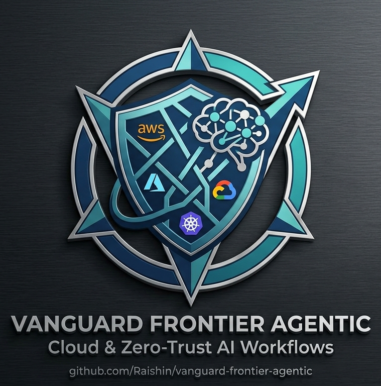
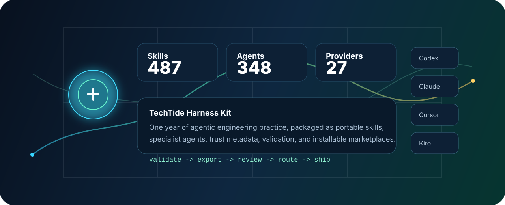
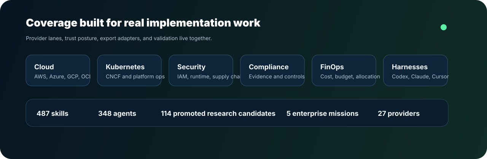
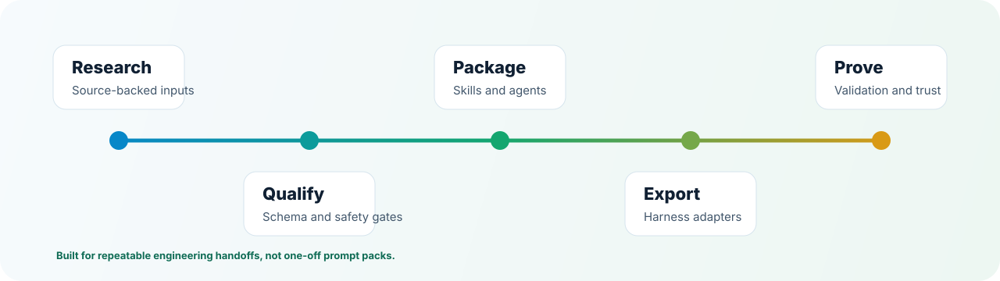

<div align="center">



# TechTide Harness Kit

**The enterprise skill platform for AI coding agents.**<br/>
385 production skills. 348 specialist agents. 6 cloud providers. 7 harnesses. One repo.

<br/>

<a href="https://www.npmjs.com/package/@techtideai/harness-kit"></a>
<a href="LICENSE"></a>
<a href="https://github.com/TechTideOhio/techtide-harness-kit/actions/workflows/codeql.yml"></a>
<a href="https://scorecard.dev/viewer/?uri=github.com/TechTideOhio/techtide-harness-kit"></a>
<a href="https://docs.npmjs.com/generating-provenance-statements"></a>

<br/><br/>

<a href="#-get-started">Get Started</a>&ensp;&middot;&ensp;<a href="#-works-with">Harnesses</a>&ensp;&middot;&ensp;<a href="#-cloud-coverage">Cloud Coverage</a>&ensp;&middot;&ensp;<a href="#-enterprise-trust">Trust</a>&ensp;&middot;&ensp;<a href="#-skill-anatomy">Anatomy</a>&ensp;&middot;&ensp;<a href="CATALOG.md">Full Catalog</a>&ensp;&middot;&ensp;<a href="CONTRIBUTING.md">Contribute</a>

<br/>



</div>

<br/>

> **Not an awesome-list.** Every skill ships with YAML-frontmatter tool scoping, inline assessment questions, safety checklists with blast-radius checks, and 9 JSON Schema contracts enforcing shape at CI time. Built for teams that answer to auditors, not just developers.

<br/>

## Why this exists

**What it does.** Ships 385 skills and 348 specialist agents as a schema-validated catalog (`skills/`, `agents/`, `catalog/`, `schemas/`), exporters that package them for Claude Code, Codex, Cursor, Copilot, Gemini CLI, Kiro, and Lovable (`scripts/export-marketplace-agents.mjs`, `plugins/`, `powers/`, `.claude-plugin/`), and a `npm run validate` chain of 25+ gates that checks frontmatter, tool scopes, link syntax, asset integrity hashes, MCP trust matrices, and plugin manifests before the package is published to npm as `@techtideai/harness-kit`.

**Who it serves.** Platform, cloud, and security engineers who want agent skills with declared tool permissions, approval gates, and provenance they can show an auditor, and maintainers who need one source tree exported to several agent harnesses without copying files by hand.

**Why Alex built it.** The repository opened on 2026-05-18 as a "showcase release" (`bbc5aad`). [AGENTS.md](AGENTS.md) states the purpose: a "cloud and zero-trust agentic marketplace for skills, agents, rules, MCP references, and npm distribution" that optimizes for "evidence-backed security workflows: least privilege, source grounding, manifests, validation, and safe automation". [TRUST.md](TRUST.md) records the reasoning behind the gates: "skills are treated as behavior packages that can influence tool use, so every public asset needs source evidence, scoped permissions, security notes, and human accountability." Four days in, a dedup pass removed 96 harness-clone skills and added a hash-collision CI gate (`f93e8bb`, 2026-05-22: "487 -> 391 unique production skills"), and the Agent Plugins 1.0 distribution landed on 2026-09-05 (`894952c`). Built by Alex Cinovoj, Founder & CTO of TechTide AI.

**Real-world use case (2025-2026 evidence).** **Verified in this repository.** A team adopts Agent Skills, the folder-plus-`SKILL.md` format Anthropic introduced on 2025-10-16[^1] that is now an open specification with required `name` and `description` frontmatter and an optional `allowed-tools` field[^2], and installs this catalog into Claude Code through a plugin marketplace, the distribution mechanism Anthropic shipped on 2025-10-09[^3]. Before every release `npm run validate` fails if any skill's `allowed-tools`, metadata, or integrity hash drifts, and the OpenSSF Scorecard workflow (`.github/workflows/scorecard.yml`; Scorecard v5.6.0 was released 2026-10-12[^4]) publishes the supply-chain posture reported by the badge above. The install paths and the packed npm artifact are exercised on every push by `.github/workflows/install-paths-smoke.yml` and `.github/workflows/packed-artifact-smoke.yml`, which is the evidence behind the verified label.

[^1]: Anthropic, "Introducing Agent Skills", <https://claude.com/resources/articles/skills>, published 2025-10-16.
[^2]: Agent Skills, "Specification", <https://agentskills.io/specification>, updated 2026-08-04.
[^3]: Anthropic, "Customize Claude Code with plugins", <https://claude.com/resources/articles/claude-code-plugins>, published 2025-10-09.
[^4]: ossf/scorecard, release v5.6.0, <https://github.com/ossf/scorecard/releases/tag/v5.6.0>, published 2026-10-12.

<br/>

## &ensp;Works With

<table>
<tr>
<td align="center" width="25%">

<br/>

<a href="docs/integrations/installation-guide.md#2-claude-code-anthropic"></a>

**Anthropic Claude Code**

Native plugin marketplace. One command installs 348 agents with full trust metadata.

```
/plugin marketplace add
  TechTideOhio/techtide-harness-kit
```

<a href="docs/integrations/installation-guide.md#2-claude-code-anthropic">Install guide &rarr;</a>

<br/>

</td>
<td align="center" width="25%">

<br/>

<a href="docs/integrations/installation-guide.md#4-cursor"></a>

**Cursor AI IDE**

Plugin directory integration. Clone once, get schema-validated skills across every provider lane.

```
git clone TechTideOhio/
  techtide-harness-kit
# Add as plugin directory
```

<a href="docs/integrations/installation-guide.md#4-cursor">Install guide &rarr;</a>

<br/>

</td>
<td align="center" width="25%">

<br/>

<a href="docs/integrations/installation-guide.md#7-openai-codex"></a>

**OpenAI Codex**

Marketplace plugin with dual-plugin architecture. Full agent catalog plus MCP trust references.

```
codex plugin marketplace add
  TechTideOhio/techtide-harness-kit
```

<a href="docs/integrations/installation-guide.md#7-openai-codex">Install guide &rarr;</a>

<br/>

</td>
<td align="center" width="25%">

<br/>

<a href="docs/integrations/lovable-skills.md"></a>

**Lovable**

One ZIP per skill. Generate archives, upload to workspace. Vibe-coding with enterprise guardrails.

```bash
npm run lovable:write
# Upload ZIPs to Lovable workspace
```

<a href="docs/integrations/lovable-skills.md">Import guide &rarr;</a>

<br/>

</td>
</tr>
</table>

<details>
<summary><strong>More harnesses:</strong> GitHub Copilot, Gemini CLI, Kiro</summary>

<br/>

| Harness | Install | Format |
| --- | --- | --- |
| **GitHub Copilot** | `copilot plugin marketplace add TechTideOhio/techtide-harness-kit` | `.github/plugin/` manifest |
| **Gemini CLI** | `npx thk-export-agents --platform gemini --all --repo .` | Workspace skill adapters |
| **Kiro** | Add `powers/techtide-*` directories in Kiro panel | Powers packages |

Full comparison and install paths: [docs/integrations/installation-guide.md](docs/integrations/installation-guide.md)

</details>

<br/>

## &ensp;Get Started

```bash
npm install @techtideai/harness-kit

# Validate everything (25+ gates, no secrets required)
npm run validate

# Export agents for your harness
npx thk-export-agents --platform claude-code --provider aws --repo .
npx thk-export-agents --platform codex --role cloud-security-engineer --repo .
npx thk-export-agents --platform gemini --all --repo .
```

<br/>

## &ensp;By The Numbers

| | | | |
| :---: | :---: | :---: | :---: |
| **385** | **348** | **6** | **33** |
| Production skills | Specialist agents | Cloud providers | Provider lanes |
| | | | |
| **9** | **25+** | **7** | **12** |
| JSON Schema contracts | Validation gates | Harness adapters | Core agent skills |

<br/>

## &ensp;Cloud Coverage

Every cloud has deep, provider-specific skills with inline assessment questions and validation checklists -- not generic templates with names swapped.



<table>
<tr>
<td width="50%">

**Major Cloud Providers**

| Provider | Skills | Highlights |
| --- | ---: | --- |
| **GCP** | 51 | AlloyDB AI, Anthos, Cloud Run, GKE, WAF (50+ questions) |
| **AWS** | 47 | WAF pillars, Bedrock security, Cost Explorer, IAM |
| **Alibaba** | 43 | ACK, AnalyticDB, China compliance, ActionTrail |
| **Huawei** | 43 | GaussDB HA, CCE, Cloud Eye, CBR backup |
| **OCI** | 41 | Autonomous DB, Cloud Guard, Full Stack DR |
| **Azure** | 36 | AI Foundry, AKS, App Service, Entra ID, WAF |

</td>
<td width="50%">

**Infrastructure & Governance**

| Lane | Skills | Highlights |
| --- | ---: | --- |
| **TechTide** | 24 | Production audit, agent autopsy, MCP trust |
| **Marketing** | 14 | Ad fairness (FHA/ECOA/EU AI Act), data min. |
| **Core** | 12 | Context mgmt, security, prompt hardening |
| **NVIDIA** | 12 | CUDA kernels, TensorRT-LLM, Triton, NGC |
| **Kubernetes** | 10 | External Secrets, RBAC, admission control |
| **CNCF** | 11 | Argo, Cilium, Falco, Istio, Kyverno, Velero |
| **FinOps** | 7 | Cross-cloud cost governance, showback |
| **European** | 30 | Hetzner, Contabo, IONOS, OVHcloud, Scaleway |

</td>
</tr>
</table>

<br/>

## &ensp;Skill Anatomy

Every skill follows a consistent, agent-optimized structure with least-privilege tool scoping:

```
skills/<provider>/<skill-id>/
  SKILL.md            # YAML frontmatter + workflow + assessment questions + checklist
  metadata.json       # Schema-validated: id, version, harnesses, official_docs
  references/         # Safety checklists, official sources, extended guidance
```

<table>
<tr>
<td width="50%">

**Frontmatter declares tool scope**

```yaml
---
name: techtide-aws-waf-reliability-review
description: "Review AWS workload reliability..."
allowed-tools: Read Grep Glob
metadata:
  author: "github: TechTide"
  version: "0.1.0"
  category: resilience
---
```

No `Write`. No `Bash`. No network. Least-privilege by default.

</td>
<td width="50%">

**Inline assessment questions + checklists**

```markdown
## Assessment Question Bank
### Compute and Autoscaling
1. Are all stateless tiers behind autoscaling?
2. Is scale-in protection set for in-flight?

## Validation Checklist
- [ ] Multi-AZ for all production compute
- [ ] Autoscaling configured for stateless
- [ ] Backup restore tested in last 30 days
- [ ] Circuit breakers on external calls
```

</td>
</tr>
</table>

<br/>

## &ensp;What Ships

| Surface | Purpose |
| --- | --- |
| `skills/` | Portable task workflows with frontmatter, assessment questions, and guardrails |
| `agents/` | Specialist roles with harness-specific adapters |
| `rules/` | Harness-specific operating guidance |
| `mcp/` | Trusted MCP server integration references |
| `catalog/` | Machine-readable indexes, trust metadata, roles, and integrity hashes |
| `schemas/` | 9 JSON Schema contracts enforcing skill and agent shape |
| `powers/` | Kiro Power packages |
| `plugins/` | Codex and Claude Code plugin packages |



<br/>

## &ensp;Enterprise Trust

<table>
<tr>
<td width="50%">

**Security & governance layers**

| Layer | What it does |
| --- | --- |
| Schema validation | 9 JSON Schemas enforce skill shape and trust fields |
| Tool scoping | `allowed-tools` in frontmatter -- least-privilege |
| Safety checklists | Blast radius, rollback paths, data impact |
| Approval gates | Read-first, approval-gated, target-confirmed |
| Trust metadata | Tool scopes, data classes, network posture |
| Provenance | npm provenance + SHA asset integrity hashes |
| CodeQL | Automated security scanning on every push |
| OpenSSF Scorecard | Supply chain security posture |

</td>
<td width="50%">

**Trust documentation**

| Document | Purpose |
| --- | --- |
| [TRUST.md](TRUST.md) | Trust posture and verification model |
| [DATA-HANDLING.md](DATA-HANDLING.md) | Data handling and privacy practices |
| [PROMPT-INJECTION.md](PROMPT-INJECTION.md) | Prompt injection defenses |
| [CONTROL-MAPPING.md](CONTROL-MAPPING.md) | Compliance control mapping |
| [SECURITY.md](SECURITY.md) | Vulnerability reporting |
| [EVALS.md](EVALS.md) | Evaluation and validation summary |

</td>
</tr>
</table>

<br/>

## &ensp;Security

Report vulnerabilities through [SECURITY.md](SECURITY.md). The findings below were open on the repository's Dependabot and code-scanning dashboards as of 2026-10-20. They are documented here rather than dismissed.

| Finding | Status |
| --- | --- |
| `braces` 3.0.3, [GHSA-vfj7-8cjw-p6xm](https://github.com/advisories/GHSA-vfj7-8cjw-p6xm) (stack-exhaustion denial of service through deeply nested patterns) | Known upstream advisory with no fixed release as of 2026-10-20. It reaches this repository only as a devDependency transitive (`@semantic-release/commit-analyzer` -> `micromatch` -> `braces` in `package-lock.json`) used by the release workflow; the published npm package declares no runtime dependencies, so consumers do not install it. The Scorecard `Vulnerabilities` check reports the same advisory. No code-level mitigation exists in this repository. |
| OpenSSF Scorecard `Code-Review` | Scorecard found 0 of the last 19 changesets with an approving review from a second account. That is an accurate description of a single-maintainer project: changes land through pull requests with CI gates, but no independent reviewer approves them. It is a process finding, not a code defect, and it stays open until a second maintainer reviews changes. |
| OpenSSF Scorecard `Pinned-Dependencies` | `.github/workflows/packed-artifact-smoke.yml` installs the tarball it just built with `npm install` inside a throwaway consumer project. There is no registry version to pin because the artifact comes from the same job. |
| OpenSSF Scorecard `Fuzzing` and `CII-Best-Practices` | The repository runs property-based tests with fast-check (`npm run test:fuzz`) but is not registered with OSS-Fuzz, and it has not applied for an OpenSSF Best Practices badge. |
| CodeQL `js/unused-local-variable` (two notes in `scripts/proof-layer.mjs`) | Dead code, not a security defect: an unused `posix()` helper and an unused `proofSources` list of external references. Left for a deliberate code change by the maintainer because the list may be intended for future use. |

<br/>

## &ensp;vs Alternatives

| Feature | TechTide Harness Kit | Awesome lists | Toolkit repos |
| --- | :---: | :---: | :---: |
| **Production skills** | 385 | Links only | 35-184 |
| **Cloud providers** | 6 | 0 | 1-2 |
| **Schema validation** | 9 schemas, 25+ gates | None | None |
| **Trust metadata** | Per-skill scopes + approval gates | None | None |
| **Safety checklists** | Blast radius + rollback | None | None |
| **Multi-harness** | 7 adapters | 1 | 1-2 |
| **Assessment questions** | Provider-specific banks | None | None |
| **Enterprise governance** | OpenSSF, CodeQL, provenance | None | None |
| **European cloud** | 5 providers, 30 skills | None | None |
| **NVIDIA / GPU** | CUDA, TensorRT, Triton | None | None |

<br/>

## &ensp;Common Commands

```bash
# Validate everything (25+ gates)
npm run validate

# Check trust + proof layer
npm run trust:check && npm run proof-layer:check

# Export agents
npm run agents:export -- --list
npm run agents:export -- --platform claude-code --provider aws --repo .
npm run agents:export -- --platform codex --all --repo .

# Regenerate artifacts
npm run proof-layer:write && npm run plugin-manifest:write
```

<br/>

## &ensp;Documentation

| Topic | Link |
| --- | --- |
| Installation guide | [docs/integrations/installation-guide.md](docs/integrations/installation-guide.md) |
| Harness compatibility | [docs/compatibility.md](docs/compatibility.md) |
| Cross-harness skills | [docs/cross-harness-skills.md](docs/cross-harness-skills.md) |
| Marketplace model | [docs/marketplace-model.md](docs/marketplace-model.md) |
| Quality bar | [docs/quality-bar.md](docs/quality-bar.md) |
| Taxonomy | [docs/taxonomy.md](docs/taxonomy.md) |
| Lovable skill imports | [docs/integrations/lovable-skills.md](docs/integrations/lovable-skills.md) |
| External skill research | [docs/external-skill-research.md](docs/external-skill-research.md) |

<br/>

## &ensp;Contributing

Contributions should be evidence-backed, source-grounded, and safe by default.

1. Read [CONTRIBUTING.md](CONTRIBUTING.md)
2. Run `npm run validate` before opening a PR
3. Every skill needs: `SKILL.md` with frontmatter, `metadata.json` matching schema, and official doc references

Report vulnerabilities through [SECURITY.md](SECURITY.md). Do not open public issues containing exploit details, real credentials, customer data, or internal system identifiers.

---

<div align="center">

<br/>

**Built by [TechTide AI](https://techtideai.io/)** &ensp;&middot;&ensp; [Alex Cinovoj](https://www.linkedin.com/in/alexcinovoj) &ensp;&middot;&ensp; Columbus, Ohio

[Star this repo](https://github.com/TechTideOhio/techtide-harness-kit/stargazers) if it helps your team ship safer agent workflows.

<br/>

</div>
